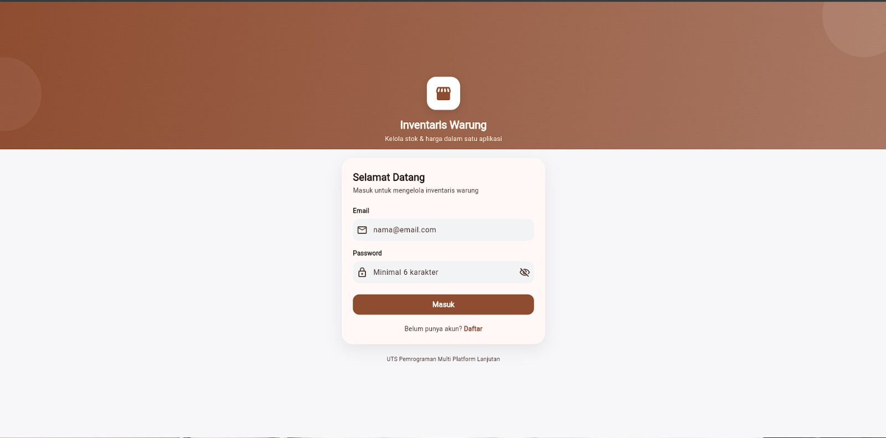
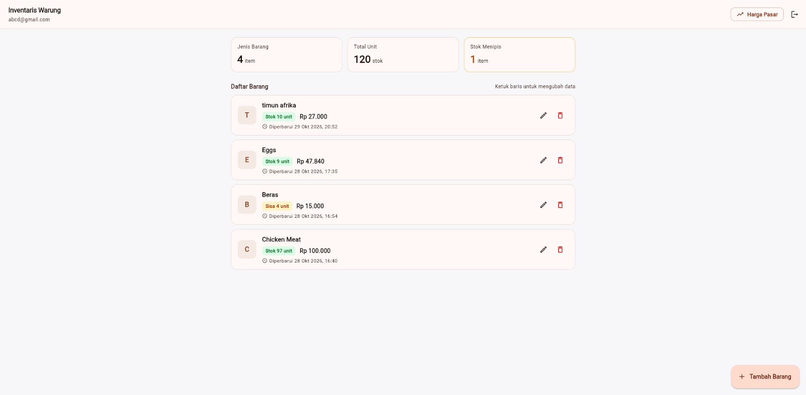
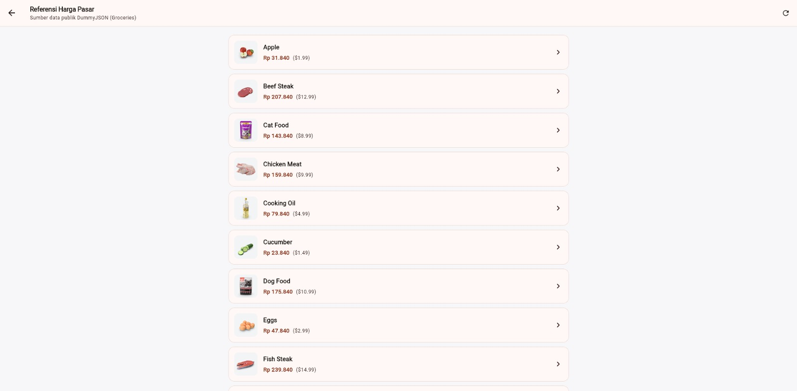
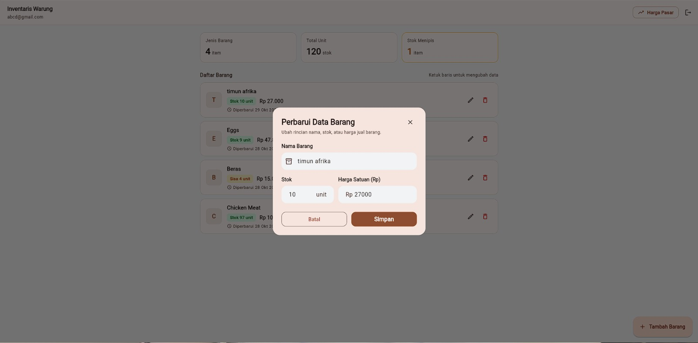

# Inventaris Warung

Aplikasi manajemen stok barang warung dan referensi harga pasar berbasis Flutter, Firebase Authentication, Cloud Firestore, Provider, dan Dio REST API. Proyek ini disusun untuk memenuhi Ujian Tengah Semester (UTS) mata kuliah Pemrograman Multi Platform Lanjutan (Kelompok TA5J) di Institut Sains dan Bisnis Atma Luhur Pangkalpinang.

## Daftar Anggota Kelompok

Pembagian peran mengacu pada ketentuan spesifikasi tugas:

| Peran | NIM | Nama | Tanggung Jawab |
| :--- | :--- | :--- | :--- |
| Anggota 1 | 2411500048 | Erick Oktavianto | Auth + navigasi + struktur folder |
| Anggota 2 | 2411500057 | Framlie Derren Cristian | Firestore CRUD + Model/Service/Provider + ViewState |
| Anggota 3 | 2411500047 | Devid Winata Herwandi | Dio REST API + loading/error/empty + Future vs Stream |

## Fitur Aplikasi

1. **Autentikasi Pengguna (Firebase Auth)**
   * Registrasi akun baru dan masuk menggunakan Email dan Password.
   * Pemantauan sesi pengguna secara *real-time* menggunakan `Stream<User?>` (`authStateChanges()`).
   * Fitur keluar (*Logout*) yang langsung mengarahkan kembali ke halaman masuk.

2. **Manajemen Inventaris Warung (Cloud Firestore CRUD)**
   * Menggunakan `CollectionReference` pada koleksi `items` dengan struktur dokumen `{name, stock, price, createdAt}`.
   * **Create**: Menambahkan data barang baru beserta waktu pencatatan (`Timestamp`).
   * **Read**: Menampilkan daftar barang secara *real-time* menggunakan `Stream` (`snapshots()`) dan pengurutan di sisi klien (Dart) tanpa menggunakan `.orderBy()` pada kueri Firestore. Tersedia juga fungsi pembacaan satu kali berbasis `Future` (`get()`).
   * **Update**: Memperbarui nama, jumlah stok, harga satuan, serta waktu pembaruan terakhir.
   * **Delete**: Menghapus barang dari inventaris dengan dialog konfirmasi.
   * Menampilkan ringkasan jumlah jenis barang, total unit stok, serta indikator peringatan stok menipis.

3. **Referensi Harga Pasar (Dio REST API)**
   * Mengambil data katalog produk kategori *groceries* (kebutuhan pokok) secara *read-only* dari API publik DummyJSON (`https://dummyjson.com/products/category/groceries`) menggunakan paket `dio`.
   * Menampilkan halaman daftar produk beserta estimasi konversi harga ke Rupiah (IDR) dan halaman rincian produk.
   * Fitur menyalin produk dari referensi pasar langsung ke dalam inventaris warung di Firestore.

4. **Manajemen State (Provider & MultiProvider)**
   * Menerapkan `MultiProvider` pada `main.dart` dengan tiga `ChangeNotifier`: `AuthProvider`, `ItemProvider`, dan `ApiProvider`.
   * Menggunakan pola `ViewState` (`loading`, `loaded`, `error`, `empty`) pada provider Firestore dan Dio.
   * Menangani pembersihan *stream subscription* melalui metode `dispose()` untuk mencegah kebocoran memori (*memory leak*).

## Struktur Folder

```text
lib/
├── firebase_options.dart
├── main.dart
├── models/
│   ├── item_model.dart
│   └── product_model.dart
├── providers/
│   ├── api_provider.dart
│   ├── auth_provider.dart
│   └── item_provider.dart
├── screens/
│   ├── api_detail_screen.dart
│   ├── api_list_screen.dart
│   ├── home_screen.dart
│   └── login_screen.dart
├── services/
│   ├── api_service.dart
│   └── firestore_service.dart
└── theme/
    └── app_theme.dart
```

## Tangkapan Layar (Screenshot)

> Catatan: Simpan gambar tangkapan layar aplikasi ke dalam folder `screenshots/` pada repositori, lalu sesuaikan nama file di bawah ini.

| Halaman Login / Register | Halaman Home CRUD Inventaris |
| :---: | :---: |
|  |  |

| Halaman List API (Harga Pasar) | Halaman Detail API |
| :---: | :---: |
|  |  |

## Cara Menjalankan Aplikasi

Pastikan perangkat Anda telah terpasang Flutter SDK, Git, dan Node.js (opsional untuk Firebase CLI).

### 1. Kloning Repositori dan Unduh Dependensi

```bash
git clone https://github.com/uts-pmp-lanjutan-Iridium/uts_pmp_lanjutan.git
cd uts_pmp_lanjutan
flutter pub get
```

### 2. Konfigurasi Firebase (`flutterfire configure`)

File `lib/firebase_options.dart` sudah disertakan di dalam repositori ini (tidak dimasukkan ke `.gitignore`) sehingga aplikasi dapat langsung dijalankan.

Apabila ingin menghubungkan ulang proyek ke akun Firebase milik sendiri menggunakan FlutterFire CLI, ikuti langkah berikut:

```bash
# 1. Login ke akun Firebase
firebase login

# 2. Aktifkan FlutterFire CLI
dart pub global activate flutterfire_cli

# 3. Jalankan konfigurasi ulang pada direktori proyek
flutterfire configure
```

Saat menjalankan `flutterfire configure`:
* Pilih proyek Firebase yang digunakan (contoh: `inventaris-warung`).
* Pilih platform target (Android, iOS, Web, Windows) lalu tekan Enter.
* Perintah tersebut akan memperbarui file `lib/firebase_options.dart`.
* Pastikan layanan **Authentication** (metode *Email/Password*) dan **Cloud Firestore** sudah diaktifkan pada Firebase Console.

### 3. Jalankan Proyek

```bash
# Menjalankan di Chrome (Web)
flutter run -d chrome

# Atau menjalankan di perangkat Android / Emulator / Windows
flutter run
```

## Tautan Video Presentasi

* **Google Drive**: [Tautan Video Presentasi Kelompok](https://drive.google.com/) *(Ganti dengan tautan Google Drive video kelompok Anda sebelum pengumpulan)*
